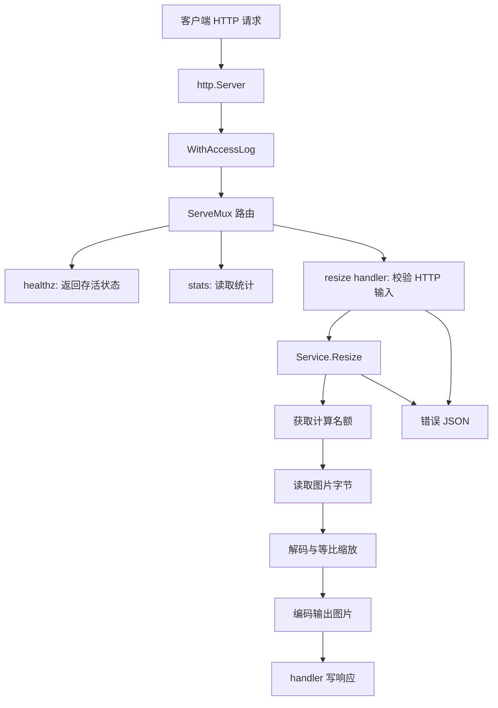

# image-processor 源码导读

> 核对日期：2026-10-11（Asia/Shanghai）
>
> 本机项目：`D:\GO\image-processor`
>
> 阅读基线：`codex/mvp-baseline` 分支，业务源码对应提交 `b9c4243`；工作区的依赖声明有未提交调整。下文按实际读取的文件解释，源码链接指向这个已存在的提交。
>
> 适用目的：较长时间未看代码后，重新建立对整个项目的理解。文档中的源码摘录保留关键语句；省略部分请对照原文件。

## 阅读方式

建议分三轮看，不必先记住所有 Go 语法：

1. **恢复整体印象**：看第 1–3 节，知道服务做什么、对象在哪里创建、请求往哪里走。
2. **跟随实际源码**：看第 4–12 节，打开对应文件，理解每个关键函数的输入、输出、状态和资源。
3. **准备继续开发与面试**：看第 13–18 节，把测试、实现边界、修改位置和常见追问连接起来。

忘记语法时查第 17 节。先能讲清一条请求，再逐步补足并发、内存和退出细节。

## 1. 当前项目到底做什么

这是一个 Go HTTP 服务。客户端上传 JPEG/PNG 图片并指定目标宽度，服务按原始长宽比计算目标高度，缩放后把编码后的图片作为响应返回。

例如：原图 `1600×900`，目标宽度 `320`，计算后的尺寸是 `320×180`。响应体是图片字节，错误时则返回 JSON。

当前接口：

| 接口 | 输入 | 成功输出 | 当前用途 |
|---|---|---|---|
| `POST /resize` | multipart 表单：`file`、`width` | JPEG/PNG 图片字节 | 实际图片处理 |
| `GET /healthz` | 无业务参数 | `{"status":"ok"}` | 检查进程是否能处理这个 HTTP 请求 |
| `GET /stats` | 无业务参数 | 请求及池相关的计数字段 | 查看进程内统计 |

当前处理是**同步的**：一个请求需要等到读取、解码、缩放、编码结束，才能拿到图片结果。服务不会把业务结果持久化保存。上传解析过程可能使用临时文件，这是实现细节，不是结果存储系统。

MySQL、Redis、Docker Compose、任务 ID、后台 worker 和结果下载都属于后续可投递版本的计划，目前没有对应业务实现。现有 channel 是计算并发信号量，不能算已经实现了后台任务队列。

### 1.1 三个容易混淆的“图片”

一次处理会经过三种表示：

```text
上传的 JPEG/PNG 压缩字节
    → 解码后的像素图像
    → 缩放后的像素图像
    → 重新编码的 JPEG/PNG 字节
```

文件字节数、图像像素数和输出字节数是不同的量。小压缩文件可能解码成占用较多内存的图像；当前 10 MiB 文件上限不能直接保证解码内存也小于 10 MiB。

## 2. 目录、依赖和阅读入口

```text
D:\GO\image-processor\
├── cmd/server/main.go                    程序入口、组装和退出
├── configs/config.yaml                   当前运行参数
├── internal/
│   ├── config/config.go                  读配置、转换类型、校验
│   ├── server/
│   │   ├── http.go                       创建服务对象和注册路由
│   │   └── logging.go                    包装响应写入并记录访问日志
│   ├── process/
│   │   ├── types.go                      JSON 错误响应类型
│   │   ├── handler.go                    HTTP 参数与业务错误转换
│   │   ├── service.go                    读取、解码、缩放、编码
│   │   ├── handler_test.go               参数错误路径验证
│   │   └── handler_success_test.go       真图片与损坏图片验证
│   ├── pool/
│   │   ├── bytes.go                      实际使用的 sync.Pool 方案
│   │   └── sizeclass.go                  尚未接入的 channel 分档方案
│   └── stats/stats.go                    原子计数和读取
├── go.mod / go.sum                       模块声明、依赖版本及校验
├── README.md                             当前启动与状态说明
└── docs/                                 源码导读和优化计划
```

`cmd/server` 是可执行程序，里面的包名为 `main`。`internal` 内的包承载实现细节。Go 对 internal 包有导入范围限制：导入方必须位于其父目录对应的树内；当前项目的外部模块不能随意导入这些包。

### 2.1 哪些包依赖哪些包

| 包 | 主要依赖 | 职责 |
|---|---|---|
| `main` | `config`、`server`、`stats` | 创建对象、启动服务器、管理退出 |
| `config` | YAML、文件与时间 API | 把文件转换成可用配置 |
| `server` | `config`、`process`、`stats` | 组装 HTTP 入口 |
| `process` | `pool`、`stats`、Go 图片库、x/image | HTTP 适配和图片处理 |
| `pool` | `sync` 或 channel | 复用字节缓冲区 |
| `stats` | `sync/atomic` | 并发安全的单字段计数 |

`service.go` 不接收 HTTP 的 `ResponseWriter`，因此图片处理与响应状态码分开。它可以由其他入口调用，但这些入口仍需要满足其参数与资源约束，不能认为换入口就不需要校验。

### 2.2 go.mod 和 go.sum

实际工作区的模块名是 `image-processor`，Go 声明版本为 `1.25.4`。两个直接使用的第三方依赖是：

- `golang.org/x/image v0.39.0`：目前使用 `draw.BiLinear.Scale`。
- `gopkg.in/yaml.v3 v3.0.1`：把 YAML 解码到结构体。

模块名也决定了 `image-processor/internal/config` 这样的导入路径。`go.mod` 描述版本选择；`go.sum` 保存下载内容的校验信息，不是运行配置。

当前工作区把 x/image 的 `indirect` 标记去掉，并补了 check.v1 校验记录。这些依赖整理尚未提交，不代表添加了新的业务组件。

## 3. 先看清两条流程

### 3.1 启动流程只做一次

```text
main
  → 读取 -config 参数
  → config.Load
  → stats.New
  → server.NewRouter
       → 创建一个 Service
       → 创建并注册 handler
  → 创建 http.Server
  → 启动监听
  → 等待退出信号
```

这里会创建共享的 `Stats`、`Service` 和路由。它们不会在每个请求进来时重新创建。

### 3.2 每次请求经过的路径



错误 JSON 实际由 handler 写出，Service 只返回错误。图中的错误路径表示错误向上返回后的结果。

### 3.3 对象的寿命不同

| 对象 | 创建位置 | 一般持续多久 | 是否共享 |
|---|---|---|---|
| `cfg` | `main` | 服务运行期间 | 当前按已加载值使用 |
| `st *Stats` | `main` | 服务运行期间 | 多个请求共享，使用原子操作 |
| `svc *Service` | `NewRouter` | 路由运行期间 | `/resize` 请求共享，包括同一个信号量 |
| 返回的 handler 函数 | `NewResizeHandler` | 路由运行期间 | 捕获同一组依赖 |
| `r *http.Request` | HTTP 服务器 | 一次请求 | 每个请求不同 |
| 处理 `ctx` | resize handler | 一次处理阶段 | 每个请求派生 |
| 上传数据、像素图像、输出缓冲区 | `Resize` | 本次计算及响应所需期间 | 不应当被其他请求任意使用 |
| `bufPools` | pool 包级变量 | 进程期间 | 多个请求共享池；池内对象可被回收 |

这里最重要的是：**所有 resize 请求使用同一个计算名额池**。如果每个请求创建自己的容量 4 的信号量，就无法约束整个服务的处理并发。

## 4. main.go：程序入口怎样组装服务

文件：[cmd/server/main.go](https://github.com/wuyh266/image-processor/blob/b9c4243/cmd/server/main.go)。

### 4.1 读取命令行和配置

```go
configPath := flag.String("config", "configs/config.yaml", "path to config file")
flag.Parse()
cfg, err := config.Load(*configPath)
```

`flag.String` 返回 `*string`。`flag.Parse()` 把命令行参数解析到该值，`*configPath` 取出实际路径。默认路径相对当前工作目录，因此建议从项目根目录启动。

`config.Load` 失败会进入 `log.Fatalf`：打印错误并退出进程，不继续运行一个配置不完整的服务。

### 4.2 共享统计和路由

```go
st := stats.New()
router := server.NewRouter(cfg, st)
```

`Stats` 的指针被传给路由与处理服务，避免各层维护互不相干的计数。配置在启动时组装，当前没有文件热加载。

### 4.3 HTTP 服务器与基础 context

```go
serverCtx, serverCancel := context.WithCancel(context.Background())
defer serverCancel()
```

这是服务运行级的取消信号。`http.Server.BaseContext` 返回它，让服务器接受的请求使用这条 context 链；请求级 context 还包含 HTTP 服务器自己的取消行为。

`srv.Handler = router` 指定所有请求交给哪个 HTTP handler。这里的 `router` 已经包含访问日志中间件。

### 4.4 为什么监听放在 goroutine 中

`ListenAndServe` 会阻塞。主 goroutine 还需要等 Ctrl+C 并执行退出流程，所以代码用 `go func() { ... }()` 启动监听。

正常 `Shutdown` 会让监听调用返回 `http.ErrServerClosed`，代码把它视为预期结果。其他监听错误，例如端口被占用，会通过 `log.Fatalf` 退出。

退出流程在第 12 节单独展开。

## 5. config.go：配置怎样变成运行参数

文件：[internal/config/config.go](https://github.com/wuyh266/image-processor/blob/b9c4243/internal/config/config.go)，配置：[configs/config.yaml](https://github.com/wuyh266/image-processor/blob/b9c4243/configs/config.yaml)。

### 5.1 先对照实际配置

| 配置项 | 当前值 | 实际使用位置 | 作用 |
|---|---|---|---|
| `server.addr` | `:8080` | `http.Server.Addr` | 监听地址；通常监听该端口的可用接口 |
| `read_header_timeout` | `5s` | `http.Server` | 读取请求头的时间预算 |
| `read_timeout` | `30s` | `http.Server` | 读取请求（包括请求体）的网络时间限制 |
| `write_timeout` | `30s` | `http.Server` | 响应写入相关的网络时间限制 |
| `idle_timeout` | `120s` | `http.Server` | keep-alive 连接空闲等待时间 |
| `shutdown_timeout` | `10s` | `main` 的 Shutdown context | 等待退出的时间预算 |
| `process.timeout` | `15s` | resize handler | 从表单校验完成后开始的处理 context 时间预算 |
| `max_concurrent` | `4` | `Service.sem` 容量 | 并发进入 Service 处理的名额数 |
| `max_file_size` | `10485760` | `Service.maxFileSize` | 10 MiB 单文件读取上限 |
| `pool.enabled` | `true` | `Service.poolEnabled` | 选择池化读取或普通读取 |
| `pool.capacity` | `64` | 解析、校验后没有传入实际池 | 当前不会控制运行中的池容量 |

网络超时、业务 context、退出预算分别控制不同阶段。它们不是一个统一的“图片处理一定在某秒数内完成”的保证。

### 5.2 rawConfig 与 Config 的分工

`rawConfig` 对应文件里的写法：时间是 `"5s"` 这样的字符串，字段带有 `yaml:"..."` 标签。大写字段可被 YAML 库通过反射访问；小写类型名 `rawConfig` 仅在 config 包内使用。

`Config` 是其他代码使用的类型。其时间字段为 `time.Duration`，程序可以直接把它们交给 context 或 HTTP 服务器。

```text
YAML 文件的字符串和数字
    → rawConfig
    → convert：解析时间并组装
    → validate：检查约束
    → Config
```

这让配置错误在启动阶段暴露，而不是在第一张图片到来时才发现。

### 5.3 Load、convert 和 validate

`Load(path)` 有三步：`os.ReadFile` 获取字节，`yaml.Unmarshal(data, &raw)` 填充结构体，`convert(raw)` 返回可用配置。`&raw` 是变量地址，让库可以写入该变量。

`mustParseDuration` 调用 `time.ParseDuration`。虽然名字带 `must`，当前实现仍返回 `(time.Duration, error)`，没有自行 panic。阅读行为以函数体为准。

`convert` 逐个转换时间，构造 `Config`，再调用 `validate`。`validate` 检查地址非空、各超时和容量为正数。

当前校验只覆盖这些条件，没有验证所有字段之间的关系或合理上限。例如 `pool.capacity` 即使通过正数检查，也不代表它已经实际生效。

### 5.4 错误包装的意义

```go
return Config{}, fmt.Errorf("read config file: %w", err)
```

`Config{}` 是零值结构体。`%w` 给底层错误增加“读配置文件”这样的上下文，并保留可检查的错误关系。调用方既能看到处理阶段，也能继续用 `errors.Is` 等机制识别底层原因。

## 6. http.go：路由、接口与闭包

文件：[internal/server/http.go](https://github.com/wuyh266/image-processor/blob/b9c4243/internal/server/http.go)。

### 6.1 NewRouter 做的是装配

`NewRouter(cfg, st) http.Handler` 创建 `http.NewServeMux()`，注册三个路径，创建一个 `Service`，最后返回 `WithAccessLog(mux)`。

`mux` 根据请求路径选择 handler。这里注册的是路径，方法限制由每个 handler 内的 `r.Method` 判断，因此 `/resize` 的 GET 请求会进入 resize handler 后返回 405。

`/healthz` 和 `/stats` 在这里直接定义。`/resize` 的函数体较长，放到 process 包，通过 `NewResizeHandler` 创建后注册。

### 6.2 Handler 和 HandlerFunc 怎样连接

`http.Handler` 是具有 `ServeHTTP` 方法的接口。`http.HandlerFunc` 是函数类型，并提供满足该接口的方法，因此普通形状的处理函数可以成为 HTTP handler。

项目同时用到：`ServeMux` 作为 handler，中间件返回的 `HandlerFunc` 作为 handler，以及 `HandleFunc` 注册路径函数。它们最终都能被服务器通过 `ServeHTTP` 调用。

### 6.3 工厂调用一次，返回函数执行多次

```go
func NewResizeHandler(svc *Service, timeout time.Duration, st *stats.Stats) http.HandlerFunc {
    return func(w http.ResponseWriter, r *http.Request) {
        // 实际请求处理逻辑
    }
}
```

这是闭包：返回的函数在以后执行时，仍能使用创建它时的 `svc`、`timeout` 和 `st`。

```text
启动阶段：NewResizeHandler(...) → 得到一个函数 → 注册到 mux
请求阶段：这个函数被调用 → 获取本次 w、r → 使用捕获的依赖
```

工厂函数签名描述它需要的依赖。每个请求的 `w`、`r` 属于本次调用，共享的 Service 和 Stats 则来自闭包。

## 7. handler.go：HTTP 输入怎样转换成业务调用

文件：[internal/process/handler.go](https://github.com/wuyh266/image-processor/blob/b9c4243/internal/process/handler.go)。

### 7.1 两个参数先记住

`r *http.Request` 用于读取请求的方法、路径、头部、表单和 context。`w http.ResponseWriter` 用于设置响应头、状态码和响应体。

设置响应头应发生在响应状态/正文提交之前。项目遵循 `Header().Set → WriteHeader → Write/Encode` 的主要顺序。

### 7.2 校验是按顺序执行的

| 顺序 | 语句/函数 | 验证什么 | 失败状态 |
|---|---|---|---|
| 1 | `st.RecordRequest()` | 先记录本次 resize 入口调用 | — |
| 2 | `r.Method != http.MethodPost` | 必须 POST | 405 |
| 3 | `r.ParseMultipartForm(32 << 20)` | 请求能被解析成 multipart 表单 | 400 |
| 4 | `r.FormFile("file")` | 上传文件字段存在且可打开 | 400 |
| 5 | `detectFormat(contentType)` | 声明类型为 image/jpeg 或 image/png | 415 |
| 6 | `r.FormValue("width")` | 宽度字符串存在 | 400 |
| 7 | `strconv.Atoi(widthStr)` | 宽度能转换为整数 | 400 |
| 8 | `width < 10 || width > 4096` | 宽度在有效区间 | 400 |
| 9 | `svc.Resize(...)` | 执行读取和图片处理 | 由返回错误决定 |

每个失败分支增加错误计数，写 JSON，然后 `return`。这样不会继续向下解码图片。

### 7.3 multipart、Content-Type 与文件句柄

multipart 请求体把字段和文件分成多个部分。这里的 `file` 和 `width` 都属于这个请求体。

`32 << 20` 是 32 MiB。传给 `ParseMultipartForm` 的值控制文件部分保留在内存中的阈值；剩余部分可以存到临时文件，整个请求仍会被解析。它不能代替总请求大小限制。[Go 1.25.4 的 API 说明](https://pkg.go.dev/net/http@go1.25.4#Request.ParseMultipartForm)

`FormFile` 返回文件对象和文件头。文件对象提供读取能力，也需要关闭，因此使用 `defer file.Close()`。传给 Service 时，只使用它的 `io.Reader` 能力。

`header.Header.Get("Content-Type")` 来自文件部分的声明。`detectFormat` 只匹配这个字符串，**没有检查图片字节**。后续 `image.Decode` 才真正尝试识别和解码内容。

这也意味着：图片能否解码、客户端声称的格式、最终选择的输出格式，当前并未完全统一校验。

### 7.4 处理 context 从哪里开始计时

```go
ctx, cancel := context.WithTimeout(r.Context(), timeout)
defer cancel()
result, err := svc.Resize(ctx, file, width, format)
```

这段在表单解析与参数检查之后执行，15 秒预算不包含之前的完整上传解析时间。`r.Context()` 使处理 context 关联到请求取消，`defer cancel()` 在 handler 结束时释放派生 context 的资源。

是否能及时退出，还取决于下层有没有观察这个信号。当前 Service 只在等待并发名额的位置检查它，详情见第 8 节。

### 7.5 Service 错误怎样翻译成 HTTP

| `Resize` 返回的错误 | HTTP 状态 | JSON error |
|---|---|---|
| `context.DeadlineExceeded` | 504 | `process timeout` |
| `context.Canceled` | 408 | `request canceled` |
| `ErrFileTooLarge` | 413 | `file too large` |
| `ErrDecode` | 422 | `failed to decode image` |
| 其他错误 | 500 | `internal server error` |

这是当前项目的状态码选择，不是所有服务必须采用的唯一映射。客户端已经断连时，服务即使尝试写取消响应，也不保证对方能够收到。

`errors.Is` 检查错误链。直接比较 `err == ErrDecode` 只能识别未包装的同一个错误，而 Service 会用 `%w` 包装解码错误。

### 7.6 types.go 与 JSON 辅助函数

文件：[internal/process/types.go](https://github.com/wuyh266/image-processor/blob/b9c4243/internal/process/types.go)。

```go
type ErrorResponse struct {
    Error string `json:"error"`
}
```

字段 `Error` 是 Go 名称，JSON 标签决定输出键是小写 `error`。例如 `ErrorResponse{Error: "width is required"}` 编码后得到对应 JSON 对象。

`writeJSONError` 创建这个结构体，交给 `writeJSON`；后者设置 JSON Content-Type、写状态码，再用 `json.NewEncoder(w).Encode(v)` 输出。

参数 `v any` 允许编码不同形状的值。当前 JSON 编码错误没有单独处理，是后续改进时应知道的边界。

### 7.7 成功响应是图片字节

Service 返回成功后，handler 先 `RecordSuccess()`，再设置图片 Content-Type，写 200 和 `result`。

当前成功计数表达的是“业务计算已返回成功”。`w.Write(result)` 的返回错误被忽略，所以这个计数不能用来证明完整图片已经送达客户端。

## 8. service.go：真正的图片处理核心

文件：[internal/process/service.go](https://github.com/wuyh266/image-processor/blob/b9c4243/internal/process/service.go)。

### 8.1 Service 结构与构造函数

```go
type Service struct {
    sem         chan struct{}
    maxFileSize int64
    poolEnabled bool
    st          *stats.Stats
}
```

`sem` 保存计算名额；`maxFileSize` 限制读入字节；`poolEnabled` 选择读取方案。`st` 虽然被保存到 Service，当前 `Resize` 没有使用它记录池行为。

`NewService` 创建 `make(chan struct{}, maxConcurrent)`，返回 `*Service`。`Resize` 的 `(s *Service)` 是接收者，表示这个函数是 Service 的方法，调用形式为 `svc.Resize(...)`。

参数 `file io.Reader` 只要求输入具有读取字节的能力，既可以来自上传文件，也可以来自内存缓冲区。返回 `([]byte, error)` 表示图片结果字节或错误。

### 8.2 channel 怎样限制处理并发

```go
select {
case s.sem <- struct{}{}:
    defer func() { <-s.sem }()
case <-ctx.Done():
    return nil, ctx.Err()
}
```

容量 4 的 channel 最多容纳 4 个占位值。进入处理前发送一个值，方法结束时接收一个值释放名额。空结构体 `struct{}` 在这里仅表达“占了一个名额”，不承载图片数据。

第五个请求要等某个名额被释放；若等候时 context 取消，可以走另一条分支。`defer` 让成功、解码错误、文件超限等返回路径都释放已经取得的名额。

三个边界需要记清：

- 这限制进入 Service 后的处理，不限制之前的 multipart 解析。
- channel 容量不是等待者数量上限，更多 HTTP 请求仍可能等待。
- 同时可执行的 select 分支没有取消优先级：若 context 已取消而发送也可执行，仍可能取得名额。[Go select 语义](https://go.dev/ref/spec#Select_statements)

取得名额后，当前代码没有在读文件、解码、缩放和编码之间再次检查 ctx。这就是为什么不能把它描述为“15 秒后立刻停止所有图片计算”。

### 8.3 为什么多读 1 个字节

设上限为 `N`。如果只读 N 字节，无法区分原文件恰好 N 字节还是更大。使用 `io.LimitReader(file, N+1)`，最多读到 N+1 字节；读到多出的那一字节就证明超限，不需要把完整大文件全部读入 Service。

注意：这里限制的是 Service 的读取。之前 `ParseMultipartForm` 可能已经处理了整个上传请求。

### 8.4 开启池：ReadFull 的实际含义

```go
bufSize := int(s.maxFileSize + 1)
buf := pool.GetBuf(bufSize)
defer pool.PutBuf(bufSize, buf)
lr := io.LimitReader(file, s.maxFileSize+1)
n, err := io.ReadFull(lr, buf)
```

`ReadFull` 尝试填满指定切片。正常的小图片只有部分字节，因此通常返回 `io.ErrUnexpectedEOF`，代码专门接受这个结果，再使用 `buf[:n]` 作为实际图片数据。

| 读取情况 | 一般返回 | 当前分支如何处理 |
|---|---|---|
| 读满 N+1 字节 | `n=N+1, err=nil` | 判断 `n>N`，返回文件超限 |
| 读到部分内容，输入结束 | `0<n<N+1, ErrUnexpectedEOF` | 接受实际内容，继续解码 |
| 一开始就没有字节 | `n=0, EOF` | 视为普通读取错误，返回到 handler 的 500 分支 |
| 其他读取故障 | 对应错误 | 包装后返回 |

前两行解释了代码为什么不能简单写 `if err != nil { return ... }`。API 的 EOF 区分见 [io.ReadFull](https://pkg.go.dev/io#ReadFull)。

当前上限 N 为 10 MiB，所以每次池化读取都借用约 10 MiB 的切片。即使实际文件只有 200 KiB，这个缓冲区的容量仍按最大上限申请。

### 8.5 关闭池：ReadAll 的路径

普通分支执行 `io.ReadAll(io.LimitReader(file, N+1))`，检查返回字节长度是否大于 N，再进入图片解码。

读取策略不同，也带来一个待验证的行为差异：空输入在 ReadAll 路径通常得到空字节和 nil 错误，随后解码失败映射为 422；池化路径按前面的 ReadFull 条件可能映射为 500。这是源码推演，当前基线测试尚未专门覆盖空文件。

### 8.6 解码：从压缩字节得到像素

```go
img, _, err := image.Decode(bytes.NewReader(imgData))
if err != nil {
    return nil, fmt.Errorf("%w: %w", ErrDecode, err)
}
```

`bytes.NewReader` 把已有字节切片提供成 Reader。`image.Decode` 识别已注册的格式并产生像素图像；导入 jpeg/png 包同时使用它们的编码函数，也让这些格式的解码器完成初始化注册。

第二个返回值本来是实际识别的格式，当前用 `_` 丢弃。因此前面客户端声明的格式仍用于决定输出，代码没有检查声明与实际格式是否一致。

`ErrDecode` 是包级哨兵错误。这里同时包装错误类别和底层原因：handler 可以按类别映射 422，调试时也保留解码失败原因。当前项目 Go 版本支持这种多个 `%w` 的包装形式。

当前先完整解码再检查 `Bounds`。还没有在解码前限制像素数，压缩大小不能替代这个检查。

### 8.7 缩放：尺寸和像素缓冲区

```go
bounds := img.Bounds()
srcW := bounds.Dx()
srcH := bounds.Dy()
newH := targetWidth * srcH / srcW
if newH < 1 {
    newH = 1
}
dst := image.NewRGBA(image.Rect(0, 0, targetWidth, newH))
draw.BiLinear.Scale(dst, dst.Bounds(), img, bounds, draw.Over, nil)
```

`Bounds` 给出图像矩形，`Dx/Dy` 是宽高。代码先检查源尺寸为正，再按比例计算高度。整数除法会舍去小数，最小高度被调整为 1。

`1600×900 → 宽320` 的计算是 `320*900/1600=180`。`image.NewRGBA` 为目标像素创建新的缓冲区，BiLinear 使用双线性插值进行缩放。

当前仅在 handler 限制宽度，没有独立限制输出高度与总像素数。极端长宽比可能产生非常高的输出图像。此外这条处理路径没有专门实现 EXIF 方向、色彩配置等转换。

### 8.8 编码：从像素回到可传输字节

输出写入本次调用自己的 `bytes.Buffer`：格式为 png 时调用 `png.Encode`，其他情况调用 `jpeg.Encode`，JPEG 质量当前固定为 85。

目标格式来自 handler 的声明映射，当前没有独立的输出格式/质量参数。PNG 与 JPEG 的编码成本和结果特性不同，未来压测应分别记录。

编码失败用 `%w` 包装返回，没有单独的哨兵类别，handler 会走默认 500。成功则返回 `outBuf.Bytes()`。

### 8.9 输入池和输出结果的所有权

`buf[:n]` 是原输入缓冲区的一个视图，不是复制。池化输入在 Service 返回时归还；以后可能由其他请求借用。

当前返回的是另一个输出 Buffer 的字节，后续 HTTP 响应仍可持有它。Go 会管理仍被引用的内存，不会因为局部变量离开作用域就立即销毁结果。

这条边界很重要：不能把已经归还池的同一块字节内存交给异步写响应或其他仍在使用它的逻辑，否则其他请求复用后可能破坏结果。

### 8.10 当前有三类主要内存开销

1. 上传解析及读入的压缩字节。
2. 解码后的源像素和新建的目标像素。
3. 编码输出的字节缓冲区。

例如一幅 `4000×3000` 图像，如果像素表示为每像素 4 字节，仅该像素缓冲区就约 45.8 MiB；具体解码器的图像表示可能不同。因此服务总内存不能简单按 `并发4 × 文件上限10MiB` 估算。

## 9. pool 包：目前复用什么，哪些代码没有接入

文件：[bytes.go](https://github.com/wuyh266/image-processor/blob/b9c4243/internal/pool/bytes.go)、[sizeclass.go](https://github.com/wuyh266/image-processor/blob/b9c4243/internal/pool/sizeclass.go)。这两个文件属于同一个包，但提供两套不同的实现。

### 9.1 bytes.go 是当前实际使用的路径

`Service.Resize` 调用的是 `GetBuf` 和 `PutBuf`。核心结构是：

```text
bufPools: sync.Map
  key = 要申请的确切字节数
  value = *sync.Pool
      → 可复用的 []byte
```

外层 Map 查找“这个大小对应哪个池”，内层 Pool 借还缓冲区。当前 Service 通常传固定的 `maxFileSize+1`，因此同一配置下主要使用一个大小键。

```go
poolI, _ := bufPools.LoadOrStore(size, &sync.Pool{
    New: func() any {
        return make([]byte, size)
    },
})
pool := poolI.(*sync.Pool)
buf := pool.Get().([]byte)
return buf[:size]
```

逐句理解：

1. `LoadOrStore`：如果已经有这个键，返回原来的池；没有则登记传入的池。多个请求可并发调用。
2. `New`：Pool 需要新对象时分配切片。这里的闭包记住了这次构造对应的 `size`。
3. `poolI.(*sync.Pool)`：从接口值取出具体的池指针，是类型断言。
4. `pool.Get().([]byte)`：从池借对象，再断言成字节切片。
5. `buf[:size]`：把返回切片的长度调整到调用方要求的大小，共享原来的底层数组。

`LoadOrStore` 最终保存的是某个池实例，但传参中的候选 `&sync.Pool{...}` 仍会被求值。不能据此声称“池对象只构造一次，之后完全没有创建开销”；具体分配情况应由性能分析确认。

`PutBuf` 先查相同大小键，如果存在，就把切片交回那个池。当前 Service 在借用后立刻登记 `defer PutBuf(...)`，因此普通错误返回也会归还。

### 9.2 sync.Pool 的保证与边界

`sync.Pool` 适合复用临时对象，可以并发使用。运行时可以随时清除池中对象，所以 `Put` 后不保证下次 `Get` 一定取到同一对象。官方语义见 [sync.Pool](https://pkg.go.dev/sync@go1.25.4#Pool)。

这决定了几件事：

- 池里对象丢失后必须仍能通过 `New` 正确工作。
- 它不负责持久化、不实现 TTL，也不适合保存必须找回的业务结果。
- 当前没有硬性池容量控制，YAML 的 `pool.capacity: 64` 没有传入它。
- 本实现复用的是输入字节内存，图片仍要重新解码、缩放、编码。

借出缓冲区之后，只应由当前借用方操作；归还之后，不应再通过旧切片读写。Pool 的并发安全不等于同一块切片允许任意并发修改。

### 9.3 sizeclass.go 的 BytePool

另一套实现用带缓冲 channel 保存切片：

```go
type BytePool struct {
    ch        chan []byte
    classSize int
}
```

`NewBytePool(capacity, classSize)` 创建最多可保存 `capacity` 个切片的 channel。`Get` 用带 `default` 的 select 尝试取一个对象：取到且容量足够则复用；池为空或拿到的对象容量不足，则新建 `make([]byte, size)`。

`Put` 先把切片长度恢复成容量，再尝试写入 channel；channel 已满时走 `default`，放弃保留这个对象。借还操作不会为了等待池而一直阻塞。

这里的 channel 与 Service 的 channel 作用不同：

| 位置 | channel 存什么 | 控制什么 |
|---|---|---|
| `Service.sem` | `struct{}` 占位 | 同时运行的处理名额 |
| `BytePool.ch` | `[]byte` 对象 | 暂存多少个可复用切片 |

### 9.4 分档函数当前实际做了什么

`classifySize` 把请求大小分成 `≤1 KiB`、`≤4 KiB`、`≤16 KiB` 和其他四档。`GetBufClass`、`PutBufClass` 据此选择 `bytePools` 中的池。

但当前实现还有这些边界：

- 请求处理链路没有调用 `GetBufClass/PutBufClass`；启用 `pool.enabled` 仍走 bytes.go。
- `classSize` 只被保存，没有用于把实际分配大小对齐到档位。
- 四个池的容量直接写死为 64，没有读取 YAML 的 `pool.capacity`。
- 大于 64 KiB 的对象也全部落到最后一档，可能保存远大于 64 KiB 的切片。
- channel 的容量限制的是对象个数，不是保留字节总量。
- 取到容量不足的切片后没有继续寻找其他对象，而是直接新建。

所以这份代码表达了“按范围分池”的尝试，但还不能算已经接入、具有确定字节预算的分级池。虽然请求没有使用这些借还函数，包级 `bytePools` 在包初始化时仍会创建其 channel。

### 9.5 与后续 Redis 缓存的区别

| 机制 | 复用对象 | 能省掉什么 | 当前状态 |
|---|---|---|---|
| 输入缓冲池 | 内存中的字节切片 | 部分重复分配 | 已接入，收益未测量 |
| Redis 结果缓存 | 某原图与处理规格对应的结果信息/结果 | 命中时可能省掉重复计算或查询 | 尚未实现 |

以后接入 Redis 时，需要定义原图内容标识、宽度、输出格式、算法版本等如何构成键，并确认缓存是否可失效、是否可降级。不能把现在的 Pool 开关作为“结果缓存已经完成”的证据。

## 10. stats.go：统计怎样安全累加

文件：[internal/stats/stats.go](https://github.com/wuyh266/image-processor/blob/b9c4243/internal/stats/stats.go)。

`Stats` 保存六个私有的 `int64` 字段；`SnapshotData` 提供大写的导出字段和 JSON 标签，用于对外响应。

```go
func (s *Stats) RecordRequest() {
    atomic.AddInt64(&s.totalRequests, 1)
}
```

`(s *Stats)` 是方法接收者，指向共享统计对象。`&s.totalRequests` 取字段地址，原子加法让多个请求并发递增时不丢失更新。普通 `s.totalRequests++` 不能替代这里的同步。

| 字段 | 当前增量来源 | 当前含义 |
|---|---|---|
| `total_requests` | resize handler 入口 | 进入该 handler 的请求数，包括方法错误 |
| `success` | Resize 成功之后、响应写入之前 | 服务计算成功次数 |
| `errors` | resize handler 的错误返回路径 | handler 已分类记录的失败次数 |
| `pool_hits` | 没有接入实际调用 | 当前通常为 0，不能代表没有命中 |
| `pool_misses` | 没有接入实际调用 | 当前通常为 0，不能计算真实命中率 |
| `pool_puts` | 没有接入实际调用 | 当前通常为 0，不能代表没有归还 |

`Service` 中虽然保存了 `st *Stats`，当前没有用它登记池行为。`/healthz` 与 `/stats` 本身也没有增加上述请求统计。

`Snapshot()` 对每个字段分别做 `atomic.LoadInt64`。单字段读取是原子的，但这六次读取不是一笔事务：请求可能在两次读取之间完成。因此处理中或并发读取时，`total_requests` 不一定等于 `success+errors`。panic 等未走完记录路径的情况也可能影响这个关系。

这些数只在当前进程内存在，重启后归零。它们没有延迟分布、正在处理数量或队列长度，也不是持久化业务账本。选择原子操作的依据是这里的简单独立计数需求，当前没有“比锁快多少倍”的性能证据。

## 11. logging.go：怎样包住响应并记录访问日志

文件：[internal/server/logging.go](https://github.com/wuyh266/image-processor/blob/b9c4243/internal/server/logging.go)。

`WithAccessLog(next)` 接收下一层 handler，返回新的 handler。每次请求到来时，它记录开始时间，把 `ResponseWriter` 包装成 `statusRecorder`，调用 `next.ServeHTTP`，最后输出方法、路径、状态码和耗时。

```go
type statusRecorder struct {
    http.ResponseWriter
    status int
}
```

这是匿名嵌入：原来的 ResponseWriter 被保存在包装器里，`Header()` 等方法可以通过它继续调用。包装器自己定义 `WriteHeader` 和 `Write`，因此可以拦截状态码相关操作。

- 调用 `WriteHeader(code)` 时，保存 code，再交给真实 writer。
- 直接 `Write(body)` 且尚无状态时，记录 200；真实 HTTP writer 也会在首次写内容时默认提交成功状态。
- 耗时覆盖进入下游到下游返回，可能包含上传解析、等待名额、计算和响应写入。

当前日志没有请求 ID、具体图片规格、等待耗时与计算耗时的区分，不能直接用于解释缓存节省了多少计算。

### 11.1 包装器当前的边界

1. handler 完全不写响应时，包装器记录的 status 仍可能是 0，而实际服务器通常按 200 完成。
2. 多次提交最终状态时，包装器可能记录最后一次 code；HTTP 服务器实际通常采用第一次有效的最终状态。
3. 日志写在 `next.ServeHTTP` 之后，没有用 defer；下游 panic 时不会经过这条普通日志语句。
4. 这个包装器没有主动转发 `Flusher`、`Hijacker` 等可选接口；未来做流式响应时需重新评估。

标准 `net/http` 服务器通常会恢复发生在请求 handler 调用中的 panic，记录栈并中断该连接或流；不能说任意 handler panic 都会退出整个进程。若自己启动其他 goroutine，不能依赖这层恢复覆盖它们。官方说明见 [http.Handler](https://pkg.go.dev/net/http@go1.25.4#Handler)。当前项目也没有自定义 panic 到 JSON 500 的恢复中间件。

## 12. Ctrl+C 之后怎样退出

回到 [cmd/server/main.go](https://github.com/wuyh266/image-processor/blob/b9c4243/cmd/server/main.go) 的后半段。

```go
stopCtx, stop := signal.NotifyContext(context.Background(), os.Interrupt)
defer stop()
<-stopCtx.Done()

serverCancel()
shutdownCtx, cancel := context.WithTimeout(
    context.Background(), cfg.Server.ShutdownTimeout,
)
defer cancel()
err := srv.Shutdown(shutdownCtx)
```

这段摘录省略了日志与错误处理，实际顺序是：

1. 注册 `os.Interrupt`，主 goroutine 阻塞在 `stopCtx.Done()` 等待中断。
2. 收到信号后，取消共享的 `serverCtx`，让它派生出的请求 context 也能收到取消。
3. 创建独立的退出 context，当前预算 10 秒。它从 Background 派生，因此不会被第 2 步直接取消。
4. `Shutdown` 关闭监听、关闭空闲连接，并等待活动连接变成空闲；受传入 context 限制。
5. 正常关闭让 `ListenAndServe` 返回 `http.ErrServerClosed`，监听 goroutine 不会把它当异常。
6. Shutdown 错误被打印，随后 main 返回，进程退出。

`serverCancel()` 是发出取消信号；停止接受连接是 `Shutdown` 执行的事情，两者不要混为一谈。Shutdown 的等待语义见 [http.Server.Shutdown](https://pkg.go.dev/net/http@go1.25.4#Server.Shutdown)。

### 12.1 当前取消能影响到哪里

等待 Service 名额的请求可以通过 `ctx.Done()` 返回。但是已经进入读取、解码、缩放、编码的路径没有后续检查，也没有向这些 API 传入 context。取消不会强制中断 CPU 计算。

因此当前“支持 context”和“实现硬性计算截止”不是同一件事。退出预算到期后，Shutdown 会返回错误；当前没有继续等待或显式强制关闭活动连接的兜底分支。main 返回最终会结束进程，未完成工作也就不能保留。

另外，当前只注册 `os.Interrupt`，没有注册 Linux 容器通常收到的 `SIGTERM`。未来 Docker 阶段需要实际验证停止行为，而不能只根据 Windows 的 Ctrl+C 演示认定容器退出已经完善。

`defer cancel/stop` 用于释放取消、定时器和信号订阅相关资源。`log.Fatalf` 的退出不是普通函数返回，不能假设仍会走完这一套 defer 清理。

## 13. 测试文件怎样帮助你读懂实现

文件：[handler_test.go](https://github.com/wuyh266/image-processor/blob/b9c4243/internal/process/handler_test.go)、[handler_success_test.go](https://github.com/wuyh266/image-processor/blob/b9c4243/internal/process/handler_success_test.go)。

### 13.1 不启动端口也能调用 handler

```go
rr := httptest.NewRecorder()
req := httptest.NewRequest(http.MethodGet, "/resize", nil)
handler.ServeHTTP(rr, req)
```

`req` 模拟输入请求，`rr` 保存输出状态、头和响应体。因为 handler 遵守 HTTP 接口，测试可以直接调用它。

这不是一次真实网络请求：没有监听 TCP 端口，也不会自动覆盖 main、配置加载、网络超时和退出信号。但它确实执行了 handler 及其调用的 Service，是理解参数和输出行为的有效入口。

### 13.2 原有测试覆盖哪些错误

| 测试 | 主要输入 | 验证 |
|---|---|---|
| `TestResize_MethodNotAllowed` | GET /resize | 405、JSON 类型和错误内容 |
| `TestResize_NoFile` | 只有 width 的 multipart | 400 与 file required |
| `TestResize_InvalidWidth` | width=abc | 400 与 invalid width |
| `TestResize_WidthOutOfRange` | width=5 / 5000 | 400，两个子场景 |
| `TestResize_UnsupportedFormat` | 声明 image/gif | 415 |

部分用例写入 `fake-image-data`。它们会在解码之前因参数错误返回，所以假图片可以隔离要验证的分支；这些用例不能证明正常 JPEG 解码成功。

### 13.3 新增的真实图片基线

`TestResize_RealImage` 在内存生成 `80×40` 的图像，真正编码成 JPEG/PNG，再通过 multipart 上传，目标宽度 40。

它分别覆盖 JPEG/PNG 和池开/关，共四个子场景。检查：

- 状态 200 和正确的响应 Content-Type。
- 响应可以再次解码，实际编码格式符合预期。
- 输出尺寸为 `40×20`。
- 统计为总请求 1、成功 1、错误 0。

`TestResize_CorruptImage` 用非空损坏字节分别覆盖池开/关，检查 422 和错误计数，共两个子场景。

`resizeImageRequest` 是共用的 multipart 构造助手。`writer.Close()` 会结束表单边界；`FormDataContentType()` 给请求头提供包含 boundary 的完整值；`t.Helper()` 让调用失败时的位置更容易定位到具体用例。

### 13.4 现有证据与尚未覆盖的行为

2026-10-11 的上一轮基线工作已通过 `go test ./...` 和构建，记录在[优化计划](优化与深化计划.md)的 R0。本文是源码解释，不把文档编辑记成新的测试结果。

目前还没有专门验证：请求体总大小、文件恰好到上限与超过上限、空文件两条读取分支、实际格式与声明不符、像素上限、并发饱和、取消阶段、日志异常分支与退出。也没有性能对照、MySQL/Redis 集成或重启恢复测试。

测试通过只能支持它检查过的行为，不能据此声称内存安全上限、性能收益或整个服务生命周期都已验证。

## 14. 用具体请求把文件连起来

### 14.1 成功请求：PNG 等比缩放

假设上传有效的 `1600×900` PNG，file 部分声明 `image/png`，width=320：

```text
WithAccessLog 记录开始时间
  → resize handler 记录总请求
  → 校验 POST、解析 multipart、打开 file
  → 接受 image/png，把 width 解析为 320
  → 创建 15 秒处理 context
  → Service 获取共享信号量名额
  → 借输入缓冲区，最多读取 N+1 字节，检查文件上限
  → Decode 得到源像素
  → 计算高度 180，创建目标 RGBA，双线性缩放
  → png.Encode 写入本次输出 Buffer
  → 返回前归还输入缓冲区、释放名额
  → handler 记录成功，写 image/png 和输出字节
  → 关闭上传文件，取消处理 context
  → 中间件记录状态与总耗时
```

这是按源码建立的示例，不表示已经对这张具体尺寸的图片做过性能测量；真实图片基线用的是 `80×40 → 40×20`。

注意名额在 Service 返回时释放，响应写入仍发生在后面。当前信号量约束到计算完成，不包含整个结果传输期间。

### 14.2 参数错误：width=abc

请求仍会先解析 multipart、打开文件、检查声明格式，随后 `strconv.Atoi` 失败，记录错误并返回 400。它不会创建处理 context，也不会进入 Service 借名额或解码。现有测试覆盖了这条路径。

这也说明校验顺序影响成本：即使 width 无效，当前上传解析工作仍已经发生。

### 14.3 损坏图片：声明 PNG，但内容不是图片

声明检查和宽度检查能通过，之后进入 Service。非空损坏数据通常在 `image.Decode` 阶段失败，包装 `ErrDecode`，handler 返回 422。当前真实损坏图片用例验证了池开/关两条路径。

### 14.4 文件超过上限

Service 读到 N+1 字节时即可认定超过 N，返回 `ErrFileTooLarge`，handler 映射 413。但是这个文件此前已经经过 multipart 解析，较大上传可能已经消耗内存或临时磁盘。

这是源码中的检查位置与错误映射；目前没有对应边界测试。R1 首步就是把请求体总量控制前移，不让“Service 有文件限制”掩盖解析阶段的资源消耗。

## 15. 哪些实现不能被过度解读

下表用于阅读现有源码，也用于以后修正项目介绍。仓库中其他旧说明出现更强的表述时，以实际调用链和验证证据为准。

| 可能形成的印象 | 当前代码实际支持的结论 |
|---|---|
| 超时 15 秒会终止所有计算 | context 在等待名额时被检查；已开始的解码/缩放/编码没有取消检查 |
| ParseMultipartForm(32 MiB) 限制总上传为 32 MiB | 参数主要是文件部分的内存阈值，不是请求体总大小上限 |
| 文件上限 10 MiB 可以保证图片内存 10 MiB | 压缩字节和解码像素不同，还没有源/目标像素预算 |
| 并发 4 可以限制所有请求占用 | 只限制进入 Service 的处理名额；上传解析和等待者仍需独立约束 |
| 检查 Content-Type 就验证了真实格式 | 只匹配客户端 file 部分的声明；解码得到的实际格式被忽略 |
| 缓冲池已避免所有重复计算 | 复用输入内存，仍执行图片计算；收益还没有对照测量 |
| pool.capacity=64 已控制池容量 | 实际 sync.Pool 没有使用这个配置 |
| 分级池已经用于线上处理 | sizeclass.go 的借还函数没有接入 Resize |
| `/stats` 已给出真实池命中率 | 池统计记录方法尚无实际调用 |
| 取消服务 context 就停止接受请求 | 取消通知请求；Shutdown 关闭监听并等待连接 |
| handler panic 必然让整个进程崩溃 | net/http 通常恢复 handler panic；独立 goroutine 需另行考虑 |
| 测试通过代表可投递版本完成 | 当前仅是同步服务基线；部署、持久化、缓存、故障和性能证据待完成 |

这份导读描述的是当前实现与可核对的边界，不把原有设计意图写成已经落地的功能。

## 16. 后续优化应该改哪里

对照[优化与深化计划](优化与深化计划.md)，先在现有同步链路建立资源与行为约束，再接入基础设施和任务。

| 阶段 | 主要目标 | 当前对应位置 | 尚需增加的内容 |
|---|---|---|---|
| R1 | 请求/图片资源边界与取消契约 | config、handler、service、测试 | 请求体限制、尺寸预检、目标像素约束、等待策略与行为验证 |
| R2 | Docker/MySQL/Redis 实际运行 | main、config、README | 容器构建、Compose、连接配置、健康检查、迁移与存储实现 |
| R3 | 单实例异步任务与恢复 | handler 与 Service 的边界 | 任务模型、持久化领取、worker、状态查询、结果存储、有限重试 |
| R4 | Redis 结果复用与降级 | Service 前后的结果处理 | 缓存键、TTL、对象限制、故障回退、同实例重复请求合并 |
| R5 | 可复现证据与交付 | 测试、stats、logging、文档 | 对照压测、CPU/内存分析、CI、演示及设计取舍记录 |

这些是修改方向，新增目录、接口和数据库表还没有在当前源码出现。尤其 R3 的后台任务队列不能简单把现在的信号量改名就算完成。

### 16.1 为什么第一步落在 handler

R1-1 的触发点就在 `ParseMultipartForm` 前面：先按配置包装 `r.Body`，再解析表单，识别读取超限错误并映射 413。

配置层负责提供请求体预算；handler 负责 HTTP 读取和状态码；Service 继续保留单文件上限。请求体还包括字段和 multipart 边界，所以它与文件上限应分别命名、分别验证。具体预算与测试场景在实现前确定。

先把这条链路看懂，再改这一处，就能知道每项变化保护的是哪个阶段。

## 17. 本项目常见 Go 写法速查

这里仅解释阅读本仓库会直接遇到的语法；需要更深的语言细节时再查 Go 文档。

| 写法 | 在本项目中的意义 | 对照位置 |
|---|---|---|
| `package main` + `func main()` | 可执行程序入口 | cmd/server/main.go |
| `:=` | 在当前作用域声明并赋值 | cfg、err、ctx 等局部变量 |
| `*Service`、`*Stats` | 指向对象的指针类型 | handler/Service 共享依赖 |
| `&Stats{}` | 创建结构体并取其地址 | stats.New |
| `*configPath` | 解引用，读取指针指向的值 | main 中 flag 参数 |
| `(s *Service)` | 方法的接收者，可访问该对象字段 | Resize |
| `func(...) http.HandlerFunc` | 函数返回另一个函数类型 | NewResizeHandler |
| 匿名 `func` 捕获 svc/st/timeout | 闭包保存构造时传入的依赖 | handler 创建与运行分离 |
| `go func() {...}()` | 启动并调用匿名函数作为 goroutine | 监听 HTTP |
| `defer f()` | 当前函数返回时执行，多个 defer 按后登记先执行 | cancel、file.Close、PutBuf、释放名额 |
| `make(chan struct{}, n)` | 创建容量 n 的占位 channel | Service 信号量 |
| `struct{}{}` | 空结构体类型的值，用作名额占位 | 发送到 sem |
| `select` | 等待/选择可进行的 channel 操作 | 获取名额与取消 |
| `select` 中 `default` | 没有可进行操作时立即走默认分支 | BytePool 非阻塞借还 |
| `<-ctx.Done()` | 从取消通知 channel 接收，可能阻塞直到关闭 | 等待退出/取消 |
| `io.Reader` | 提供 Read 方法的接口 | Service 不绑定 HTTP 上传实现 |
| `http.Handler` | 提供 ServeHTTP 方法的接口 | router 和中间件 |
| `any` | 接口类型，可以保存不同具体类型的值 | sync.Pool.New |
| `v.(*sync.Pool)` | 类型断言；类型不符会 panic | 从 sync.Map 取池 |
| `_` | 忽略某个返回值 | Decode 的实际格式、LoadOrStore 标志 |
| `[]byte` | 字节切片，有长度、容量和底层数组 | 上传及输出数据 |
| `buf[:n]` | 前 n 字节的视图，不复制底层字节 | 实际读到的数据 |
| `len(buf)` / `cap(buf)` | 当前长度 / 可扩展到的容量 | 文件限制和池复用 |
| `32 << 20` | 左移，等于 32×2²⁰ 字节 | multipart 参数 |
| `json:"error"` / `yaml:"timeout"` | 结构体标签，告诉库外部字段名 | ErrorResponse / rawConfig |
| `fmt.Errorf("...: %w", err)` | 增加上下文并保留错误关系 | 配置/服务错误 |
| `errors.Is(err, target)` | 检查直接或被包装的目标错误 | handler 状态码映射 |
| `if err := f(); err != nil` | 在 if 作用域内声明结果再判断 | 读取、编码、关闭 |

### 17.1 defer 的时间点

`defer pool.PutBuf(size, buf)` 在登记时求值参数，调用在当前函数退出时执行；普通错误 return 也会触发。它不是“到下一行就执行”，也不是“整个 HTTP 请求结束才执行”——在哪个函数登记，就在那个函数返回时执行。

因此 Service 的归还和名额释放发生在 handler 写响应前。回头看第 8.9 节，就能理解为什么输出不能直接引用已归还的输入内存。

### 17.2 接口如何把测试与实现连接起来

Service 需要 Reader，不需要知道上传文件来自内存还是磁盘。handler 需要 ResponseWriter，不需要知道它是真正的网络连接还是测试 Recorder。接口让这些边界可以替换，但调用方仍需遵守大小限制、上下文和所有权约定。

## 18. 建议阅读顺序、体验方式与自查

### 18.1 把源码重新串起来

建议按这个顺序打开文件，第一轮忽略局部细节：

1. `README.md` 与 `configs/config.yaml`：先恢复实际启动参数与当前状态。
2. `cmd/server/main.go`：找到配置、统计、路由、监听和退出的组装点。
3. `internal/server/http.go`：确认三个接口，找到共享 Service 的创建位置。
4. `internal/process/handler.go` 与 `types.go`：看正常输入如何进入业务、错误如何变成 HTTP。
5. `internal/process/service.go`：按名额→读取→解码→缩放→编码跟一遍。
6. 两个 handler 测试文件：用可重复的输入与输出确认理解。
7. `internal/pool/bytes.go`，再看 `sizeclass.go`：区分正在使用的实现与未接入的方案。
8. `internal/stats/stats.go` 与 `internal/server/logging.go`：确认统计和日志口径。
9. `internal/config/config.go`，再回 main 的退出部分：补足启动失败和生命周期。

这不是必须通过的考试。读到不理解的函数可以先定位其调用者、输入与返回值，再看实现细节。

### 18.2 本地体验当前同步服务

在 PowerShell 中从项目根目录启动：

```powershell
Set-Location D:\GO\image-processor
go run ./cmd/server -config configs/config.yaml
```

另开一个 PowerShell 窗口，检查服务并上传自己的 PNG：

```powershell
curl.exe http://localhost:8080/healthz
curl.exe -f -X POST http://localhost:8080/resize -F "file=@D:\你的图片目录\sample.png;type=image/png" -F "width=320" -o resized.png
curl.exe http://localhost:8080/stats
```

把示例图片路径替换为真实路径；`resized.png` 写入第二个窗口的当前目录。JPEG 示例同时改文件、声明为 `image/jpeg`，并把输出命名为 `.jpg`。启动窗口按 Ctrl+C 触发第 12 节的退出流程。

如果想看错误响应，可使用现有图片把 width 改为 `abc`，同时去掉 `-f` 并取消图片输出重定向，直接观察返回的 JSON。恢复 width 后再查看 stats，就能看到成功/失败计数的变化。

需要重跑现有验证时使用：

```powershell
go test ./...
```

### 18.3 面试前可以用这些问题检查理解

| 追问 | 回答应能落到的代码或证据 |
|---|---|
| 一次上传到响应经历哪些阶段？ | handler 校验，Service 读取/解码/缩放/编码，handler 返回，日志收尾 |
| 为什么所有请求都受并发 4 约束？ | NewRouter 只创建一个共享 Service，sem 的容量为 4；解析和传输阶段不在完整约束内 |
| 第 5 个处理请求会怎样？ | 在 select 等待名额或 context 取消；当前没有独立的有界等待队列 |
| 为什么读 N+1 而不是 N？ | 需要额外一个字节区分恰好达到上限和超过上限 |
| 为什么 10 MiB 文件仍可能吃掉很多内存？ | 压缩字节、源像素、目标像素、输出 Buffer 分别占用内存 |
| 15 秒超时到底能做到什么？ | 开始于参数校验后，等待名额时可返回；不是 CPU 计算的硬中断 |
| Pool 和 Redis 结果缓存有什么区别？ | 复用内存对象与复用业务结果；Redis 尚未接入 |
| 当前池开关带来了多少提升？ | 暂无对照数据，不能报百分比；应提出样本、并发和 CPU/分配指标的测量办法 |
| 成功统计代表客户端收到图片吗？ | 在响应 Write 前记录成功，写入错误未处理；目前只能解释为计算成功 |
| 这些测试证明了什么？ | 真实格式、输出尺寸、损坏输入和部分参数错误；没有证明性能或全部故障场景 |
| 为什么先补资源边界再做异步任务？ | 异步仍调用图片处理核心，持久化不能替代上传、像素和并发限制 |

重新熟悉后的目标，是能从 main 找到共享对象，从请求定位每个阶段，并用实际代码解释资源、错误和测试边界。后续每完成一个阶段，再把对应证据补进优化计划与项目说明。
